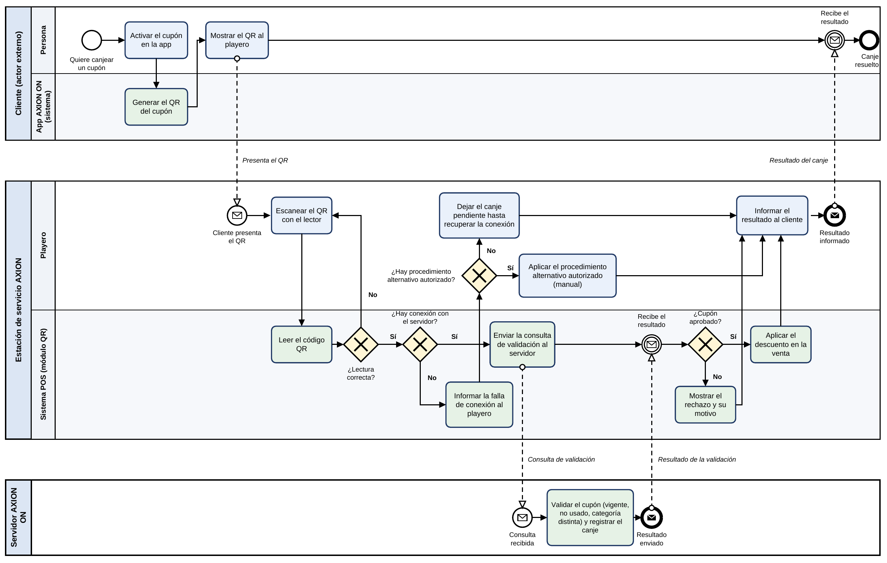

# Integración de lectura de QR en el POS de una estación AXION energy

**Trabajo Práctico Integrador y Progresivo (TPI) - Entrega N.º 4 (final)**
Organización Empresarial - Universidad Tecnológica Nacional (UTN) - Tecnicatura Universitaria en Programación a distancia

| | |
|---|---|
| **Integrante** | Ivan Alexis Sanchez |
| **Docente titular** | Prof. Gabriela Martínez |
| **Docente tutor** | Pablo García |
| **Fecha** | Noviembre de 2026 |
| **Repositorio** | https://github.com/ivanscz/tpi-organizacion-empresarial-qr-axion |
| **Tablero ágil** | https://github.com/users/ivanscz/projects/1 |

## Descripción del sistema

Proyecto de un módulo que permite **leer un código QR en el sistema de cobro (POS) de una estación de servicio AXION energy** para canjear los beneficios de la aplicación AXION ON.

Hoy el cliente activa el cupón en la app, el playero ingresa el DNI en un posnet y luego carga a mano en el POS el código del ticket. Con el módulo, el cliente muestra un QR y el playero lo escanea: el POS consulta al servidor de AXION ON, que valida el cupón y registra el canje en una sola operación. Si no hay conexión, el sistema no confirma el canje solo: informa al playero y se usa el procedimiento alternativo que autorice la empresa, o el canje queda pendiente.

El alcance es un prototipo para una estación piloto. Los plazos, los roles y los valores de rendimiento son estimaciones académicas; **no representan un proyecto aprobado ni datos oficiales de AXION energy o Pan American Energy.**

## Documentación

| Documento | Contenido |
|---|---|
| [Entrega 1](docs/entregas/Entrega_1_Caso_de_estudio_y_enfoque_sistemico.pdf) | Caso de estudio y enfoque sistémico |
| [Entrega 2](docs/entregas/Entrega_2_Diagnostico_y_planeacion.pdf) | FODA, objetivos y metas, Gantt |
| [Entrega 3](docs/entregas/Entrega_3_Estructura_formal_y_diseno_de_datos.pdf) | Organigrama y diccionario de datos |
| [Diccionario de datos](docs/diccionario_de_datos.md) | Entidades CLIENTE, CUPON, CODIGO_QR y CANJE |
| [Proceso BPMN](docs/bpmn/descripcion.md) | Participantes, flujo estándar y compuertas |
| [Historias de usuario](docs/historias_de_usuario.md) | Backlog con criterios de aceptación |
| [Indicadores de control](docs/indicadores_de_control.md) | Estándares de desempeño |

## Proceso de negocio (BPMN)

Pools: Cliente, Estación de servicio AXION y Servidor AXION ON. Lanes: Persona, App AXION ON, Playero y Sistema POS. Hay cuatro compuertas exclusivas para las excepciones (lectura, conexión, procedimiento alternativo y aprobación del cupón). Detalle en [docs/bpmn/descripcion.md](docs/bpmn/descripcion.md).

## Backlog ágil

El seguimiento se hace en el tablero de GitHub Projects (columnas **Por Hacer**, **En Progreso** y **Listo**): https://github.com/users/ivanscz/projects/1

| ID | Historia de usuario | Estado |
|---|---|---|
| HU-1 | Canje por lectura de QR | Listo |
| HU-2 | Falla de conexión y lectura | En Progreso |
| HU-3 | Registro y trazabilidad de canjes | Por Hacer |

El formato completo ("Como [usuario], quiero [funcionalidad], para [beneficio]") y los criterios de aceptación están en [docs/historias_de_usuario.md](docs/historias_de_usuario.md).

## Indicadores de control

| Indicador | Estándar |
|---|---|
| I1. Tiempo de canje con QR (M1) | 5 segundos o menos en al menos 9 de cada 10 canjes de prueba. |
| I2. Reducción del tiempo de atención (M2) | Reducción de al menos 30 % frente a la línea base medida en A1. |
| I3. Errores de carga manual (M3) | 0 códigos escritos a mano en 20 canjes de prueba. |
| I4. Rechazo de cupones ya usados (M3) | 5 de 5 intentos con un QR ya usado rechazados (resultado RECHAZADO_USADO). |
| I5. Canjes sin conexión | 5 % o menos (valor propuesto, a ajustar con los datos del piloto). |
| I6. Cumplimiento del plazo y la capacitación (M5) | 0 semanas de desvío en la ruta crítica y 100 % de playeros capacitados antes de P3. |

Fórmulas, fuentes y acciones correctivas en [docs/indicadores_de_control.md](docs/indicadores_de_control.md).

## Flujo de trabajo en Git

- `main` contiene la versión revisada de la documentación.
- Todo cambio se hace en una **rama secundaria** (`docs/...`, `feature/...`) y se integra mediante **Pull Request** con revisión de otra persona.
- Los mensajes de commit son descriptivos y siguen la convención de [CONTRIBUTING.md](CONTRIBUTING.md).

## Declaración de Uso de IA

**Herramientas utilizadas y propósito**

- Claude (Anthropic): estructura y borradores de las Entregas 2, 3 y 4, armado de los PDF, dibujo del organigrama y del diagrama BPMN, y preparación de los archivos del repositorio.
- ChatGPT (OpenAI): diagrama del sistema abierto de la Entrega 1 y mejora de la redacción y de la presentación de la Entrega 2.

**Prompts utilizados y correcciones humanas**

| Pedido a la IA | Para qué lo usé | Corrección o control humano |
|---|---|---|
| «Armar la Entrega 2 (FODA, objetivos y metas, Gantt) con la consigna, mi Entrega 1 y los PDF de la unidad». | Dar contexto completo para que el borrador use mi caso y el material de la cátedra. | El borrador suponía un grupo; aclaré que el trabajo es individual y se reescribió en primera persona. |
| «No estoy convencido del FODA, sobre todo de las debilidades internas». | Mejorar un análisis que me parecía poco creíble. | Las debilidades originales no eran convincentes; las reemplacé por limitaciones reales (experiencia limitada con sistemas de cobro, dedicación parcial, falta de entorno de pruebas). |
| «Hacé las metas más realistas y explicadas de forma más sencilla». | Simplificar metas que eran demasiado ambiciosas. | Acoté las metas y ajusté valores y plazos al editar la entrega en Word. |
| «Tené en cuenta mis anteriores entregas» (Entrega 3). | Mantener la coherencia entre las entregas. | Controlé que los cargos del organigrama coincidieran con los roles del Gantt y que el diccionario respetara el tratamiento de fallas de la Entrega 2. La primera versión estaba impersonal e ignoraba esa lógica; se corrigió. |
| «¿En qué parte del material encuentro lo del organigrama y el diccionario de datos?». | Verificar que lo entregado se apoyara en la bibliografía de la cátedra. | Comprobé que el organigrama piramidal vertical está en el apunte (Unidad 4, Tema 2) y que el diccionario de datos solo se define en la consigna. |
| «¿No tendría que verse similar a ese?» (imagen de una pirámide). | Contrastar el organigrama con un modelo distinto. | Se revisó el apunte (págs. 11 y 12): el modelo normalizado usa rectángulos y líneas, no un triángulo literal; mantuve el diseño. |
| «Si no lo pide la consigna, no lo agregues». | Ajustar el alcance a lo solicitado. | La IA había agregado «Convenciones gráficas» y «Verificación según los principios»; las eliminé. También comprobé que las medidas de los rectángulos eran propuestas de la IA y no del apunte. |
| «Agregá que los cupones no son acumulables, porque así funcionan hoy los descuentos en AXION». | Incorporar una regla de negocio que conozco por mi trabajo como playero. | La corrección salió de mi experiencia, no de la IA: se sumó el campo categoria y la regla, que también aparece en el BPMN y en la historia HU-1. |
| «Vamos a realizar la entrega final» (consigna de la Entrega 4). | Obtener un borrador del BPMN, de las historias de usuario, de los indicadores y de los archivos del repositorio. | Los contrasté con el circuito real que conozco y con las Entregas 1, 2 y 3. El umbral de 5 % de canjes sin conexión es un valor propuesto, sin datos reales; y el flujo contra el servidor es hipotético, porque no tuve acceso a la API de AXION ON. |

La asistencia de la IA no me exime de la veracidad y la coherencia del trabajo. Los plazos, los valores de rendimiento y las estructuras de datos son estimaciones académicas y no información oficial de AXION energy ni de Pan American Energy.
