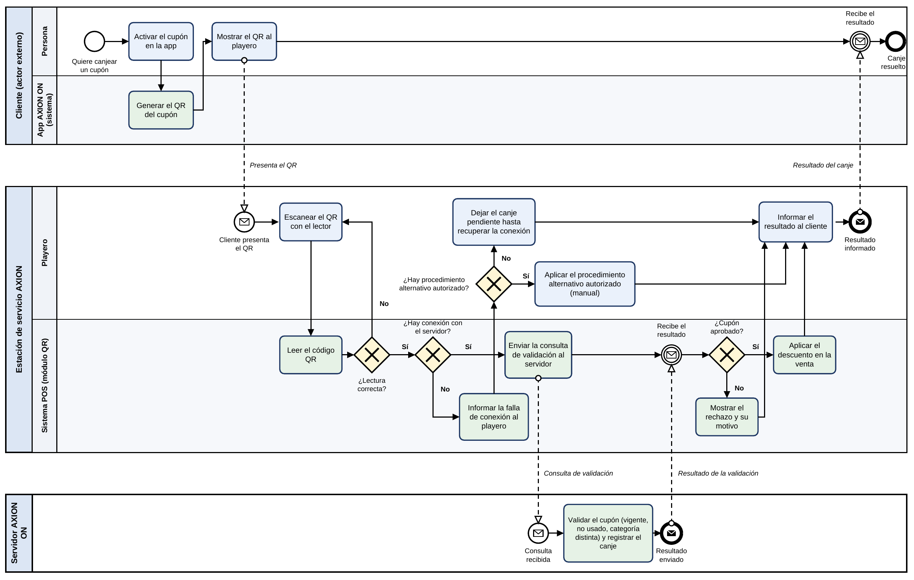

# Proceso modelado: canje de cupones con QR

Archivos: [PNG](bpmn_canje_qr.png) - [PDF](bpmn_canje_qr.pdf)

## Participantes

| Pool | Lane | Qué hace |
|---|---|---|
| Cliente (pool: actor externo) | Persona | Activa el cupón en la app y muestra el QR al playero. |
| Cliente (pool: actor externo) | App AXION ON (sistema) | Genera el QR del cupón activado. |
| Estación de servicio AXION (pool) | Playero | Escanea el QR, informa el resultado y decide cómo seguir ante una falla. |
| Estación de servicio AXION (pool) | Sistema POS (módulo QR) | Lee el QR, consulta al servidor y aplica el descuento. |
| Servidor AXION ON (pool: casa central) | Servidor | Valida el cupón y registra el canje en una sola operación. |

## Flujo estándar

1. El cliente activa el cupón en la app AXION ON y la app genera el QR.
2. El cliente muestra el QR y el playero lo escanea con el lector.
3. El POS lee el código y comprueba que la lectura sea correcta.
4. Con conexión, el POS envía la consulta de validación al servidor.
5. El servidor valida que el cupón esté vigente, no usado y de una categoría distinta a la de otros cupones de la venta, registra el canje en una sola operación y responde.
6. El POS aplica el descuento en la venta.
7. El playero informa el resultado al cliente.

## Compuertas exclusivas (excepciones)

| Compuerta | Caminos | Origen en las entregas |
|---|---|---|
| ¿Lectura correcta? | Sí: continúa. No: el playero vuelve a escanear. | Problemas de lectura del QR (Entrega 1). |
| ¿Hay conexión con el servidor? | Sí: se envía la consulta. No: se informa la falla al playero. | El sistema no confirma el canje automáticamente sin conexión (Entrega 2). |
| ¿Hay procedimiento alternativo autorizado? | Sí: se aplica de forma manual (modo ALTERNATIVO). No: el canje queda PENDIENTE. | Resultados ALTERNATIVO y PENDIENTE de la entidad CANJE (Entrega 3). |
| ¿Cupón aprobado? | Sí: se aplica el descuento. No: se muestra el rechazo y su motivo. | Cupón vencido, ya usado o de una categoría repetida (Entregas 2 y 3). |

## Convenciones

- Flechas continuas: flujos de secuencia dentro de un pool. Flechas punteadas: flujos de mensaje entre pools.
- Tareas celestes: realizadas por personas. Tareas verdes: comportamiento automatizado del sistema.
